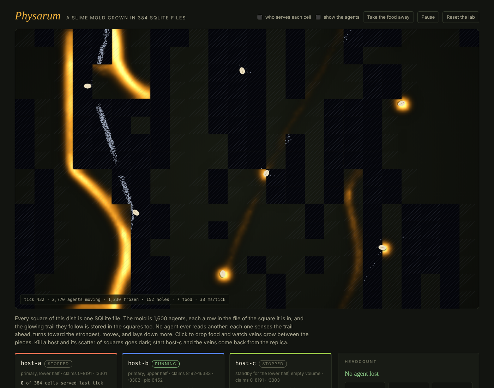

# Physarum

A slime mold grown in a SQLite fleet split between hosts. The mold's 4,000
agents and the trail they follow live in 384 tenant files of autumn-web 0.9's
fleet, with `[database.fleet.ownership]` and `[replication]` on. Drop food and
veins grow between the pieces; kill a host and the veins route around the dark
cells until the standby restores them. See `PITCH.md` for what it shows and
`docs/FINDINGS.md` for what it found.



## Run it

```sh
cargo run --release      # the dish on http://localhost:3000
```

Use the release build: 4,000 agents and four model steps a tick are slow in
debug. The console makes `./physarum-lab/`, starts host-a (`:3301`) and
host-b (`:3302`), and inoculates the dish once both serve every cell. host-c
(`:3303`) is a standby with an empty volume. Ctrl-C stops every host.

The lab directory grows about 100 MB a minute (every cell is checkpointed
every 3 s and replicated); **Reset the lab** deletes it.

| Control | What it does |
|---|---|
| Click the dish | Drop food (up to 24 pieces). |
| Take the food away | Watch the network fade and wander. |
| kill -9 / Stop cleanly / Freeze / Thaw | As in Baton and Murmuration. |
| who serves each cell | Tint cells by the host that answered last tick. |
| show the agents | Draw every agent; frozen ones are always drawn. |

## How it holds together

The live mold is in the conductor's memory; the files are its durable state.
Each cell is checkpointed about every three seconds, staggered. A cell that
changes hands is reloaded from its file, so a takeover shows exactly what the
replica held. A cell's copy of an agent is deleted only once a newer copy is
acknowledged in another cell (`verus/src/moves.rs`), so no order of
checkpoints drops an agent; only a rewind can.

## Layout

- `crates/mold` — pure: geometry, the trail (8 × 8 bytes a cell), the agents
  (Jones 2010), the checkpoint delete rule, resolution, the headcount.
- `crates/physarum-app` — `physarum-app host` (a tenant fleet; batch read and
  write of agents and trail) and `physarum-app` (supervisor, conductor, dish).
- `crates/physarum-app/tests/dish.rs` — the claims against three real host
  processes.
- `tools/drill.py` — the same through the console. `verify.sh` runs both.
- `verus/src/` — `moves.rs`, `trail.rs`, `resolve.rs`, `geom.rs`.

## Verify

```sh
./verify.sh            # fmt, clippy, tests, console + drill, routes audit, Verus
./verify.sh --quick    # without the console and the drill
```
